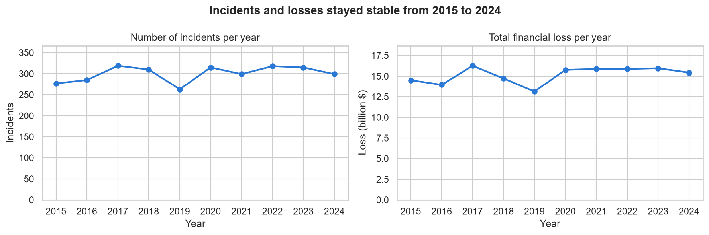
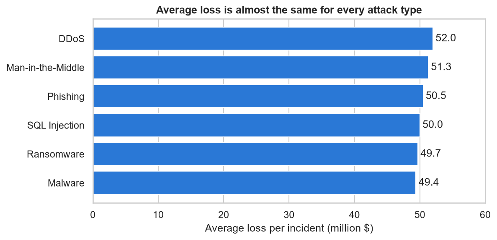
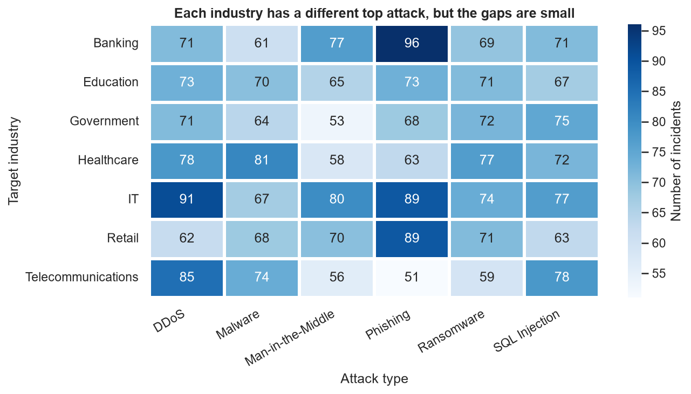
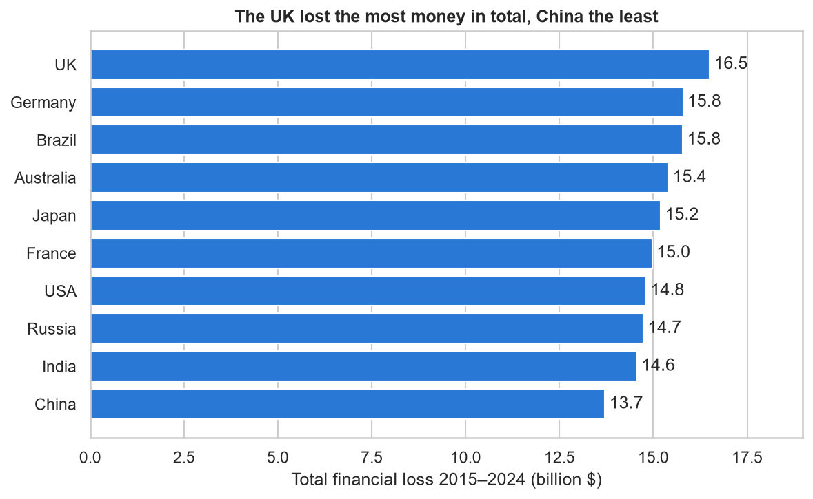
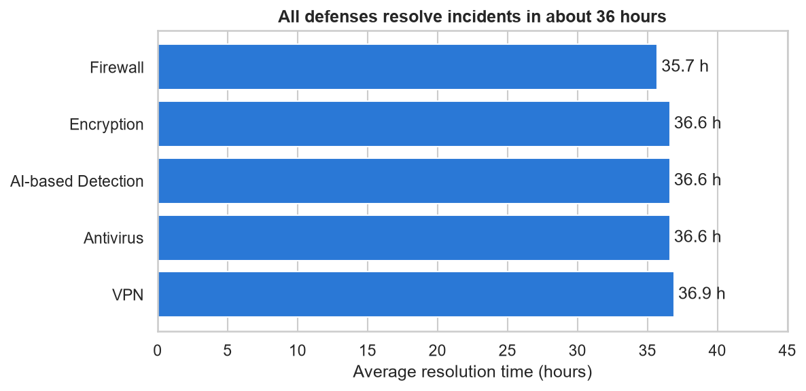

# Global Cybersecurity Threats Analysis (2015–2024)

Exploratory data analysis of 3,000 cybersecurity incidents across 10 countries and 7 industries, using **Python, Pandas, Matplotlib and Seaborn**.

## Problem Statement
Cyberattacks cost organizations billions every year. This project analyzes a decade of incident data to answer five business questions:

1. How did the number of incidents and total financial loss change from 2015 to 2024?
2. Which attack types cause the highest average financial loss and affect the most users?
3. Which industries are attacked most, and what is the most common attack type in each?
4. Which countries had the largest total financial losses?
5. Which defense mechanisms are linked to the fastest incident resolution?

## Dataset
- **Source:** [Global Cybersecurity Threats 2015–2024](https://www.kaggle.com/datasets/atharvasoundankar/global-cybersecurity-threats-2015-2024) on Kaggle
- **License:** CC0 Public Domain
- **Size:** 3,000 rows × 10 columns (country, year, attack type, target industry, financial loss, affected users, attack source, vulnerability type, defense mechanism, resolution time)
- **Note:** The numeric values are almost uniformly distributed, which suggests the dataset is **synthetic**. Findings demonstrate the analysis process rather than real-world conclusions.

## Tools
- Python 3.14
- Pandas: data cleaning and analysis
- Matplotlib & Seaborn: visualization
- Jupyter Notebook (VS Code)
- Git & GitHub

## Project Structure
```
cybersecurity-threats-analysis/
├── data/
│   ├── Global_Cybersecurity_Threats_2015-2024.csv   # raw data
│   └── cybersecurity_threats_clean.csv              # cleaned data
├── images/                                          # saved charts
├── notebooks/
│   └── 01_cybersecurity_analysis.ipynb              # full analysis
├── requirements.txt
└── README.md
```

## How to Run
```bash
git clone https://github.com/iMarwanAbdullah/cybersecurity-threats-analysis.git
cd cybersecurity-threats-analysis
python -m venv .venv
.venv\Scripts\activate        # Windows
# source .venv/bin/activate   # macOS / Linux
pip install -r requirements.txt
```
Then open `notebooks/01_cybersecurity_analysis.ipynb` in VS Code or Jupyter and run all cells.

## Key Findings

### 1. No long-term trend
Incidents (263–319 per year) and total losses fluctuated without a clear increase or decrease. Total loss moves with the number of incidents.



### 2. Attack type barely affects cost
DDoS is the most frequent and most costly attack on average (52.0M USD), but all six attack types fall within 49–52M USD.



### 3. Each industry has a different top threat
Phishing leads in Banking and Retail, DDoS in IT and Telecommunications, Malware in Healthcare, and SQL Injection in Government. IT is the most targeted industry.



### 4. The UK lost the most
The UK had the highest total loss (16.5B USD) and China the lowest (13.7B USD).



### 5. No defense is clearly faster
Average resolution time is about 36 hours for every defense mechanism.



## Recommendations
- Prioritize defenses based on the most frequent attacks **in your industry**, since losses are similar across attack types.
- Use a **layered security approach**; no single defense mechanism showed a meaningful advantage.
- Improve **attack attribution**; some incidents have an "Unknown" source.

## Limitations
- The dataset appears synthetic, so results should not be treated as real-world evidence.
- Results show correlation, not causation.
- Country totals depend on the number of recorded incidents.

## Author
**Marwan Abdullah**, Computer Information Systems student at IMSIU

- GitHub: [@iMarwanAbdullah](https://github.com/iMarwanAbdullah)
- LinkedIn: [marwan-alsuhaifi](https://www.linkedin.com/in/marwan-alsuhaifi)